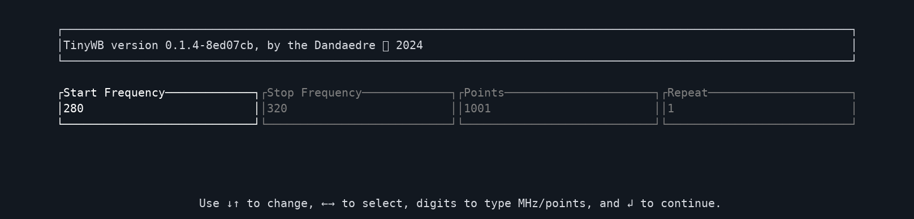
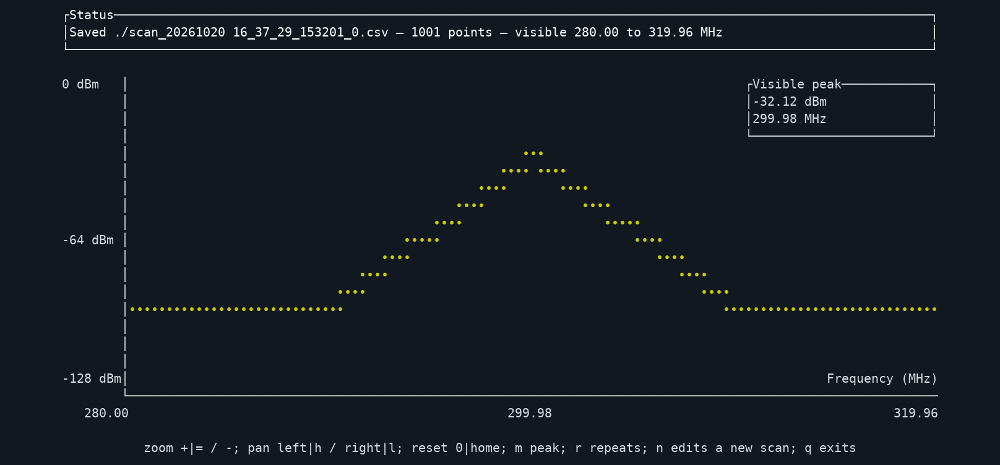

# tiny-wb


Scan a frequency range with your **tinySA**, see the spectrum in your terminal,
and save the measurements as CSV. Start with one scan; no configuration-file
editing is needed.

## Get running

You need a powered tinySA Basic, Ultra or supported Ultra+, a **data-capable USB
cable**, and access to its serial port. Close other software using the tinySA.
For a first communications check, leave external RF sources disconnected.
Before connecting a signal, read the [safe-operation guide](docs/tinysa-field-guide.md#safe-operation-read-before-connecting-a-signal).

To build from source, install Rust **1.88 or newer**, then run:

```console
git clone https://proxy.dandaedre.com/gitea/idle-org/tiny-wb.git
cd tiny-wb
cargo run --locked --release
```

Already have the checkout? Run just the last command from its root. On Linux,
building also requires the libudev development package and `pkg-config`; this
checkout's linker configuration uses `lld`.

## Your first scan

1. **Connect by USB and choose the port.** On the connection screen, select your
   tinySA's port with the arrow keys. Linux commonly uses `/dev/ttyACM0`; Windows
   uses a COM port. On macOS, select the enumerated USB serial device. Leave the
   baud rate at **115200** for the first attempt and press **Enter**.
2. **Choose a small range.** Try **Start 280**, **Stop 320** (MHz), **Points 1001**,
   and **Repeat 1**. This range uses the Basic's low input and is also within the
   supported Ultra normal range. For a connected RF signal, use the appropriate
   instrument input and safe signal level.
3. **Enter the values.** **Left/Right** selects a field. Type digits for a
   frequency or point count, then press **Enter** to apply that value. Use
   **Up/Down** to adjust a value, including Repeat. Once all fields are set,
   press **Enter** again to start the scan.
4. **Read the plot.** Wait for the scan to finish. Frequency runs left to right
   in **MHz**; level is in **dBm**. A higher point means a stronger signal.
   The app automatically saves a `scan_*.csv` in your current directory.



*Scan settings in the real application. Screenshots use the mock device; no
physical instrument or RF source is needed to reproduce this demonstration.*



*Example result from simulated data, with **m** pressed to show the peak.
Your real trace will depend on the signals and measurement setup.*

## Explore and save

| Key on the result screen | Action |
| --- | --- |
| `m` | Show or hide the strongest visible sample's frequency and level |
| `+` / `-` | Zoom in / out |
| Left / Right | Pan across the frequency range |
| `0` | Return to the full range |
| `r` | Repeat the same scan and save a new CSV |
| `n` | Edit the settings for a new scan |
| `q` | Quit |

CSV columns are **frequency in MHz, level in dBm**; by default there is no
header. Each successful scan gets a new filename. To reopen a saved scan
without connecting a device, replace `scan.csv` with your file:

```console
cargo run --locked --release -- --view scan.csv
```

Want repeated sweeps? Start with `cargo run --locked --release -- --live`, then
choose the connection and range as above. In live mode, **s** saves the visible
trace and **q** stops after the current sweep and saves it. See
[live controls](docs/tiny-wb-operations.md#live-display) for averaging and hold modes.

## If something does not work

- **No port, or access denied?** Check the USB cable, close other serial software,
  and follow the [serial-permission guide](docs/tiny-wb-operations.md#serial-permissions).
- **Timeout or no instrument detected?** Check the selected port and power, then
  consult [troubleshooting](docs/tiny-wb-operations.md#troubleshooting).
- **No tinySA yet?** Follow the [mock-device walkthrough](docs/mock-device.md)
  to try the same screens and CSV workflow with simulated data.

Settings are saved automatically in `config.toml`. See the
[configuration guide](docs/configuration.md) for output directories, keyboard
bindings and the `TINY_WB_CONFIG` override.

## Supported instruments and more

Basic low/high acquisition is supported through 960 MHz, subject to input-path
limits. Ultra-family normal-mode support covers 0.1–800 MHz; detected Ultra+
ZS406 devices also support 0.1–900 MHz and opt-in Ultra mode through 5.4 GHz.
ZS407 extended mode and harmonic reception are not supported. Check the
[compatibility matrix](docs/tiny-wb-operations.md#compatibility-matrix) and
[Ultra support scope](docs/ultra-support.md) before choosing a wider range.
Hardware communications checks do not establish RF accuracy.

- [Operations and detailed controls](docs/tiny-wb-operations.md)
- [Linux, Windows and macOS release builds](docs/releases.md)
- [Reusable Rust library](docs/library.md)
- [Development and verification](docs/security-and-ci.md#local-verification)
- [Documentation index](docs/README.md) · [Contributor instructions](AGENTS.md)

Report bugs in the [issue tracker](https://proxy.dandaedre.com/gitea/idle-org/tiny-wb/issues)
with the [reproduction details](docs/tiny-wb-operations.md#reproducible-bug-report-checklist).

Licensed under the [MIT License](LICENSE).
